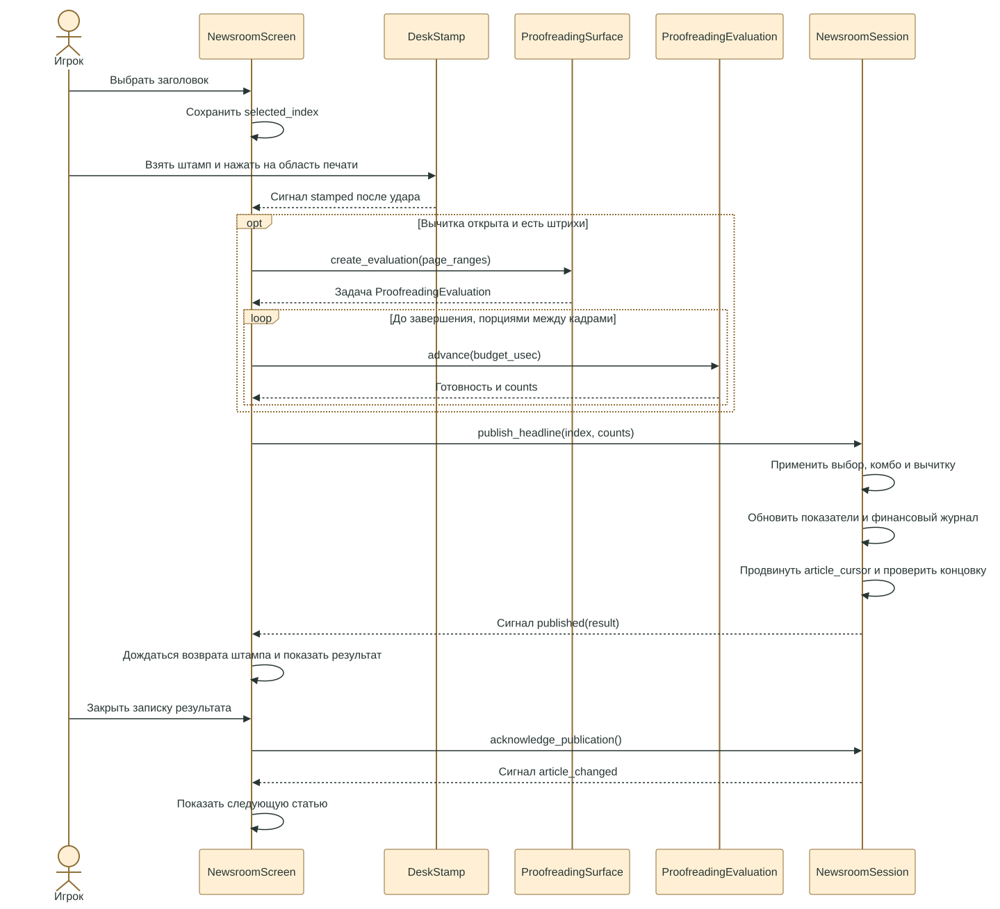

# UML игры «До печати»

Сверено с рабочей копией **19 октября 2026 года**, базовый коммит `417b674`.
Это описание реализованного устройства игры, а не предложение переписать архитектуру.

Для проекта полезны две схемы: **диаграмма классов** для поиска ответственности
и **диаграмма последовательности** для публикации статьи. Полная схема всех узлов
Godot быстро станет нечитаемой; декоративные элементы и мелкие UI-компоненты здесь опущены.

## Основные классы и скрипты

[Редактируемый источник Mermaid](Diagrams/game_classes.mmd) · [PNG](Diagrams/game_classes.png)

Синие блоки — управление экранами и вводом, золотистые — игровые данные и правила,
сиреневые — общее состояние приложения и сохранения.

- **Сплошная стрелка** — объект хранит ссылку на другой объект.
- **Пунктирная стрелка** — использование сервиса или статических функций.
- **Закрашенный ромб** — составная часть: дочерняя сцена либо объект состояния,
  создаваемый владельцем.
- `1`, `3`, `0..*` обозначают количество связанных объектов. Три варианта
  заголовка — ограничение нынешнего каталога и валидатора сохранений.

`MvpGame`, `NewsroomScreen`, `HomeScreen` и `InteractionTutorial` — удобные имена
на схеме для соответствующих скриптов. В коде у них нет объявления `class_name`.
Остальные показанные имена классов совпадают с `class_name`, кроме `GameState`:
это имя Autoload из `project.godot`.

### Как читать эту архитектуру

**`NewsroomSession` — источник истины для прохождения.** Он применяет последствия
заголовков, ведёт очередь статей, деньги, показатели, рюкзак и переходы между фазами.
Рабочий и домашний экраны вызывают его методы и реагируют на сигналы; панели магазина
сами не начисляют выносливость и не списывают деньги.

**`mvp_game.gd` координирует представление.** Он переключает экраны, показывает
сюжетные эпизоды, ведёт обучение по действиям и собирает сохранение. `View` этого
скрипта и `NewsroomSession.Phase` — разные вещи: сюжетный экран или туториал могут
отображаться при той же фазе `WORK` или `HOME`.

**Данные отделены от отображения.** Статья и её варианты заголовка — ресурсы;
числа баланса задаются `NewsroomBalance` и `Data/mvp_balance.tres`. Опечатки и штрихи
живут в `ProofreadingState`, финансовые операции — в `FinanceLedger`.

**Сохранение разделено на два уровня.** `NewsroomSaveData` переводит сессию
в данные и восстанавливает её. `mvp_game.gd` добавляет положение интерфейса,
сюжет и обучение. `SaveRepository` проверяет документ через переданный валидатор
и пишет JSON с временным файлом и резервной копией. `GameState` хранит общую сессию,
репозиторий и зарегистрированные расширения сохранения.

## Публикация статьи

[Редактируемый источник Mermaid](Diagrams/publication_sequence.mmd) · [PNG](Diagrams/publication_sequence.png)

Здесь показана обычная публикация: она не приводит к немедленному поражению,
в очереди есть следующий материал и лимит выпуска ещё не исчерпан.

- Выбор заголовка создаёт черновик; публикацию запускает сигнал штампа после удара.
- При наличии штрихов распознавание выполняется порциями между кадрами. До его
  завершения последствия публикации не применяются. Без штрихов передаются нулевые
  счётчики исправлений; пропущенные опечатки всё равно учитывает `settlement()`.
- После расчёта `NewsroomSession` применяет последствия **один раз** и сразу
  продвигает курсор очереди. Следующий лист показывается после закрытия результата.
- При поражении вместо `published` происходит переход через `phase_changed`.
  При заполненном выпуске подтверждение результата завершает смену.
- Урок карандаша тоже использует `ProofreadingEvaluation`, но только для проверки
  учебного жеста: деньги и квалификация до печати не изменяются.

## Где менять конкретную часть

| Часть | Фактические файлы |
| --- | --- |
| Корневой контроллер и экраны | [mvp_game.gd](../Scripts/mvp_game.gd), [mvp_game.tscn](../Scenes/mvp_game.tscn) |
| Правила и состояние прохождения | [newsroom_session.gd](../Scripts/newsroom_session.gd) |
| Рабочий стол и публикация | [newsroom_screen.gd](../Scripts/newsroom_screen.gd), [desk_stamp.gd](../Scripts/desk_stamp.gd) |
| Дом, магазин, рюкзак | [home_screen.gd](../Scripts/home_screen.gd), [tamagotchi_panels.gd](../Scripts/tamagotchi_panels.gd), [home_items.gd](../Data/home_items.gd) |
| Статьи и заголовки | [news_article.gd](../Scripts/news_article.gd), [headline_option.gd](../Scripts/headline_option.gd), [article_catalog.gd](../Data/article_catalog.gd) |
| Порядок статей и продолжения | [article_sequence.gd](../Scripts/article_sequence.gd), [story_chains.gd](../Data/story_chains.gd) |
| Чтение и акценты | [source_pager.gd](../Scripts/source_pager.gd), [article_emphasis.gd](../Scripts/article_emphasis.gd) |
| Карандаш и распознавание | [desk_pencil.gd](../Scripts/desk_pencil.gd), [proofreading_surface.gd](../Scripts/proofreading_surface.gd), [proofreading_evaluation.gd](../Scripts/proofreading_evaluation.gd), [proofreading_state.gd](../Scripts/proofreading_state.gd) |
| Обучение | [mvp_game.gd](../Scripts/mvp_game.gd), [interaction_tutorial.gd](../Scripts/interaction_tutorial.gd), [interface_lessons.gd](../Data/interface_lessons.gd) |
| Сохранения | [game_state.gd](../Scripts/game_state.gd), [newsroom_save_data.gd](../Scripts/newsroom_save_data.gd), [save_repository.gd](../Scripts/save_repository.gd), [SAVES.md](SAVES.md) |
| Баланс и финансовый журнал | [newsroom_balance.gd](../Scripts/newsroom_balance.gd), [finance_ledger.gd](../Scripts/finance_ledger.gd) |

Схемы намеренно не перечисляют шейдеры, декорации, отдельные кнопки и все сигналы.
Вспомогательные Autoload `AudioManager`, `GameSettings`, `CursorTooltip` также
опущены: они обслуживают звук, настройки и подсказки, а не владеют прохождением.

Обновлять UML стоит при переносе ответственности между этими блоками, изменении
публикации или сохранений. Изменение текста статьи, цвета кнопки или цены товара
само по себе перерисовки схемы не требует. Источники — `.mmd`, изображения — их экспорт.
